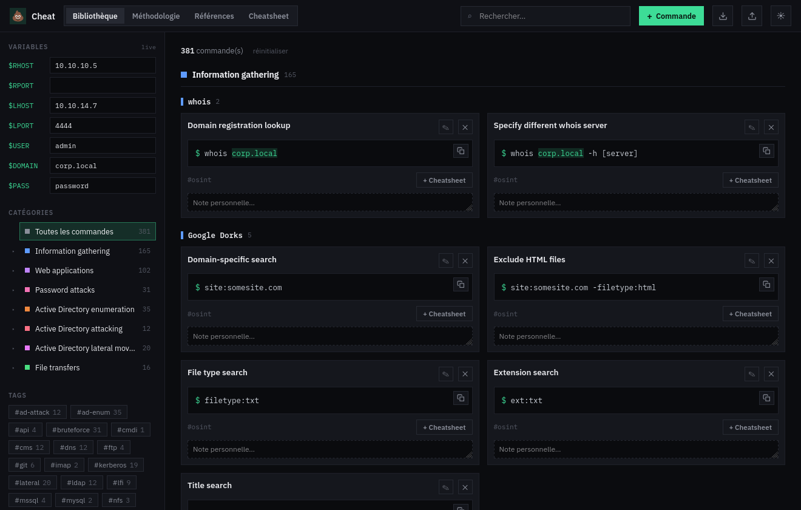

# 💩 Cheat

> **The operational memory of a pentest — commands, methodology, references and
> cheatsheets in one offline workshop, with live variables threaded through
> everything.**

**Cheat** keeps everything you reach for during a penetration test in one place —
reusable **commands**, step-by-step **methodologies**, external **references**,
and target-scoped **cheatsheets** — and resolves **live variables**
(`$RHOST`, `$LHOST`, `$USER`, …) identically everywhere a command appears. Type a
target once and every command, in every view, shows the concrete, copy-ready
line.

It's built for **OSCP** prep (the Offensive Security Certified Professional exam)
and hands-on pentest work, and runs as a **single self-contained binary** on your
own machine — no cloud, no accounts, no telemetry. The UI is in **French**.



## Contents

- [Why Cheat?](#why-cheat)
- [Highlights](#highlights)
- [Snippets](#snippets)
- [Conditional steps](#conditional-steps)
- [Live variables](#live-variables)
- [Quick start](#quick-start)
- [Configuration](#configuration)
- [Security & OPSEC](#security--opsec)
- [Import / export](#import--export)
- [Tests](#tests)
- [Tech stack](#tech-stack)
- [Project layout](#project-layout)
- [License](#license)

## Why Cheat?

During an engagement your knowledge is scattered: commands live in a dozen
cheatsheets, methodology in a notepad, useful links in the browser — and you
retype the same target IP, listener, and credentials into every one of them.

Cheat pulls it into a single workshop and makes the target **a variable**. Set
`$RHOST` once and it propagates to every command in the library, every linked
step in a methodology, and every entry in a cheatsheet. No more find-and-replace
across notes.

## Highlights

- **Bibliothèque** — a searchable command library grouped by **category → tool**
  (tools sorted alphabetically). Tokenized, accent-insensitive search; filter by
  category, tool or tag; full create/edit/delete with on-the-fly
  categories/tools/tags; per-command notes; one-click copy of the *resolved*
  command; **star a command** to pin it to the top of its tool group and reach it
  from the **★ Favoris** scope in the sidebar.
- **Méthodologie** — reusable **roadmaps** of phases and checkable steps with
  per-phase and global progress. A step can link a command, shown expanded and
  resolved inline. Edit mode with drag-and-drop reordering (including across
  phases) and a progress reset. Steps can be **conditional**: tick what discovery
  found on the target and only the relevant branches apply (see below).
- **Snippets** — reusable **chains of commands** for the goals a single command
  cannot reach (forge a silver ticket, kerberoast → crack → reuse). Ordered steps
  with inline templates, a copy button on every line, and per-snippet variables
  fed from the previous step's output (see below).
- **Références** — external links with auto-extracted domain and tags, full-text
  and tag filtering, and URL validation on add/edit.
- **Cheatsheet** — assemble named, target-scoped cheatsheets from library
  commands **and snippets** (two chapters), then **export to Markdown or PDF** — both emit raw `$TOKEN`s by
  default; a single opt-in toggle resolves the values into either format, and a
  confirmation guards any resolved export that would write a sensitive value
  (`$PASS`) to disk.
- **Live variables** — substituted everywhere, with three clear states and
  auto-detection of new ones (see below).
- **Themeable & dense** — dark / light, terminal-style, self-hosted fonts.
- **Foldable sidebar & responsive panes** — the ☰ button in the top bar folds the
  left sidebar (remembered per device), and it folds itself below 780px while
  keeping your manual choice for when the window grows back. The command and
  reference grids reflow to a single column when the pane gets narrow, and the top
  bar compacts instead of overflowing.
- **Local persistence** — everything (except variable *values*) is saved to a
  local SQLite database and survives restarts.
- **Import / export** — back up or move your whole dataset as a single JSON file.

## Snippets

Some results take several commands, where each one needs something the previous
one produced. A **snippet** captures that as a reusable technique:

```
01  Dump the service account's hash     mimikatz # sekurlsa::logonpasswords     → $svc_ntlm
02  Read the domain SID                 whoami /user                            → $domain_sid
03  Forge and inject                    mimikatz # kerberos::golden /sid:$domain_sid /rc4:$svc_ntlm /domain:$DOMAIN …
04  Use it                              dir \\$RHOST\c$
```

- **Two classes of variables.** `$UPPERCASE` are the app-wide ones from the
  sidebar. `$lowercase` are **local**: paste the value read from a step's output
  into the field that sits right under that step — and every line below turns
  green, resolved and ready to run. You can also just **double-click the token**
  inside any line to set it. See [Live variables](#live-variables).
- **Copy a line with its copy button.** A chain can't be run in one go, so every
  line carries its own copy button at its right end — the same one the command
  cards use.
- **Local values are never written anywhere.** Not to the database, not to the
  export, and **not even into a resolved Markdown/PDF export** — a `$local` always
  leaves the app as a raw token. They hold precisely what shouldn't be persisted
  (a hash, a ticket, a SID), so they live in memory only and reset on reload. The
  clipboard does resolve them, which is the whole point.
- **One value set per place.** The same snippet used in two methodology steps
  keeps two independent sets of local values, so two targets never mix.
- **Shell variables are left alone.** `$env:USERNAME`, `$PSVersionTable`, `$_`,
  `$f` and friends are ordinary shell text, never Cheat variables, so PowerShell
  and bash one-liners paste in safely. The exact rules are in
  [Live variables](#live-variables).

### Declaring a local variable — optional

A `$lowercase` token resolves **without being declared**: type `$svc_ntlm` in a
step, double-click it, give it a value. Declaring it buys you two things and
nothing else:

- a **hint** — the placeholder text of its capture field, reminding you what to
  paste there (« hash NTLM du compte de service ») ;
- the **« produit » anchor** — pick the local on the step that *yields* it, and
  its capture field moves directly under that step in the Snippets view, so you
  paste the output where it was produced and the lines below resolve.

Two ways to declare one, in the add/edit form:

1. **Write it, then adopt it.** Type `$svc_ntlm` anywhere in a step's command; a
   **`détectées : + $svc_ntlm`** chip appears next to `+ variable locale` — click
   it. This is the quicker path in practice.
2. **Declare it up front.** In the **« Variables locales »** block above the
   steps, click **`+ variable locale`**, then type the name in lower case
   (`svc_ntlm`) plus an optional hint.

The per-step **« produit »** dropdown only lists locals that already exist, so on
a fresh snippet its only option is `(rien)` until you declare one.

A declared local that no step produces still gets a field, grouped in a
**« Variables locales »** strip at the top of the snippet card.

Snippets carry a category and tags (no tool), can be linked from a methodology
step — on their own or alongside a command — and go into a cheatsheet's
« Snippets » chapter.

## Conditional steps

A generic OSCP roadmap has to list the enumeration steps for FTP, SMB, HTTP, SMTP,
SNMP, LDAP, MSSQL… On any given target most of them are off topic — and they used
to count against the progress bar, so a host running 3 services out of 12 could
never reach 100%.

So a roadmap declares its own **triggers**, and a step can be gated on them.

```
MÉTHODOLOGIE — OSCP                         ▓▓▓▓▓░░░░░  8/14
Détecté sur la cible :  [✓ FTP] [✓ SMB] [ HTTP ] [ LDAP ]

▾ 02 · Énumération
   ☑ Bannière + version des services
   ── FTP ─────────────────────────
   ☑ Tester l'accès anonyme
   ☐ Lister et récupérer les fichiers
   ── HTTP · inactif ──────────────
   ░ Fuzzing de répertoires              ← grisé, non cochable, hors progression
```

- **Declare a trigger** in « ✎ Modifier »: type its name in the « Détecté sur la
  cible » strip and hit `+ déclencheur`. Then, on any step, `＋ déclencheur` picks
  which ones make it apply. A step with none is unconditional and always applies.
- **Tick what the target runs**, outside edit mode, by clicking a chip. Every step
  carrying that trigger activates **at once, in every phase** — which is the point
  of a named trigger rather than a per-step note: "this host has an FTP" gates
  enumeration, exploitation and post-exploitation alike, and the roadmap stays
  reusable from one target to the next.
- **Several triggers on one step are OR'd** — any one being on is enough.
- **An inactive step is dimmed, not checkable, and out of the progress maths** —
  numerator *and* denominator, which is what lets a target reach 100% without the
  services it does not run. « ☐ masquer les inactives » hides them (and any phase
  left with nothing to do) when you want a clean view; edit mode ignores the
  switch, so you can always edit what this target does not need.
- **Unticking a trigger destroys nothing.** A checked step that goes inactive
  keeps its check — it just stops being counted, and re-ticking restores it.
- **Consecutive steps sharing a trigger read as a block** under a `── FTP ──`
  sub-header. That is a rendering effect only; the model stays a flat list.

### Detecting triggers from an nmap result

Paste your scan into a step's « Résultat » and hit **`⚡ détecter depuis le
résultat`**. It reads the open ports and ticks the triggers they vouch for,
reporting what changed.

```
21/tcp   open  ftp           vsftpd 3.0.3
445/tcp  open  microsoft-ds  Windows Server 2019
3389/tcp closed ms-wbt-server
        →  2 déclencheur(s) activé(s) : FTP, SMB
```

It matches on the **port** and on the **service name** — `445` or `microsoft-ds`
both mean SMB — splits a TLS-wrapped `ssl/http`, drops the trailing `?` of an
unconfirmed guess, and ignores anything that is not `open` (`closed`, `filtered`,
and `open|filtered`, which is nmap declining to say). A trigger whose name the
built-in catalogue does not know still matches by appearing in the service name,
provided it is at least 3 characters long.

**It only ever ticks, never unticks.** A chip you set by hand always wins, so the
worst a bad parse can do is find nothing. Treat it as a pre-fill you correct, not
as a source of truth.

Trigger *definitions* travel with the roadmap (including a copy to another
profile); which ones are *on* is per-target progress, so it is what
« Réinitialiser la progression » clears, alongside the checkboxes.

## Live variables

A variable is a `$TOKEN` you define once and reuse everywhere. There are **two
classes**, told apart by case alone.

**Values are memory-only, both classes.** A variable *value* (your target IP, a
password, a captured hash) is **never** written to the database, to
`localStorage`, or to the JSON export — it lives in memory and resets on reload.
Only variable *names* and command templates are stored. That is a deliberate
OPSEC choice (see below).

### `$GLOBALES` — app-wide, edited in the sidebar

Cheat ships 7 built-ins — `$RHOST`, `$RPORT`, `$LHOST`, `$LPORT`, `$USER`,
`$DOMAIN`, `$PASS` — and you can add your own.

Set `$RHOST = 10.10.10.5` in the sidebar, and a stored command template like:

```
nmap -p- --min-rate 5000 -sV $RHOST
```

renders (and copies) as `nmap -p- --min-rate 5000 -sV 10.10.10.5` — in the
library, in a methodology step that links it, and in any cheatsheet that
includes it.

- **Three render states**: *resolved* (has a value, shown green), *empty*
  (defined but blank), *undefined* (an unknown `$TOKEN`, shown dimmed).
- **Auto-detection**: type a new `$TOKEN` into any command and it appears in a
  **“Détectées”** strip in the sidebar — one click adopts it as a variable you
  can give a value.
- **Rename cascades**: renaming a variable rewrites `$OLD → $NEW` across every
  command that uses it.

### `$locales` — scoped to one category, or one snippet

A `$lowercase` token is a **local**. It isn't app-wide: it belongs to one place.
`$share` means something in *Active Directory*, nothing in *Web applications*.

- **Its scope is a category.** Fill `$share` on one command of *Active Directory*
  and **every** command of that category shows it, whatever the tool — `nxc`,
  `impacket`, `smbclient` alike — and no command of another category does. A
  `$share`, a `$spn`, a `$wordlist` describes the target or the goal, not the tool
  that consumes it.

  For a **snippet** the scope is that snippet, with one independent value set per
  place it appears (the same snippet linked from two methodology steps keeps two,
  so two targets never mix).

- **Two ways to set one.** **Double-click the token in the command** — it turns
  into an input right where you read it; Enter, Escape or clicking away closes it,
  and hovering a local shows a dashed outline to tell you it is editable. Or use
  the **« Variables locales » form** that appears in the left sidebar, under the
  global variables, as soon as you click a category. Both write the same value:
  the form is the overview, the double-click is the shortcut.
- **Empty the field and the token comes back.** A local with no value renders as
  its own `$name` again, everywhere in its scope. The form's `✕` does exactly that
  — it clears the *value*, it does not delete the variable: a local has no
  definition to delete, it exists because a template mentions it.
- **Never resolved into a file** — not the JSON export, and **not even a
  Markdown/PDF export with « résoudre les variables » ON**, which resolves globals
  only. A local holds exactly what shouldn't reach the disk (a hash, a ticket, a
  SID). The clipboard *does* resolve it, which is the whole point.

**What is deliberately *not* a variable**, so PowerShell and bash one-liners paste
in safely:

| Left as plain text | Why |
|---|---|
| `$PSVersionTable`, `$ErrorActionPreference`, `$RHOSTx` | mixed case — belongs to neither class |
| `$_`, `$__`, `$_1` | no letter at all |
| `$env:USERNAME`, `$global:x`, `$using:v` | followed by `:` — a PowerShell scope or drive prefix |
| `$f`, `$i`, `$x` | a single character — a shell loop variable |
| `$env`, `$global`, `$script`, `$local`, `$private`, `$using`, `$workflow`, `$args`, `$input`, `$true`, `$false`, `$null` | reserved names |
| `$1`, `$(whoami)`, `${HOME}`, `\$RHOST` | not the `$NAME` shape, or escaped |

Everything else in lower case is fair game: `$share`, `$path`, `$file`, `$hash`,
`$wordlist`, `$spn`, `$svc_ntlm`…

One consequence of the category scope worth knowing: two tools of the same
category using the same *name* for different things now share one value — `$path`
as a web path for `ffuf` and as an SMB path for `smbclient`. Name them apart
(`$web_path`, `$smb_path`) if you hit it.

## Quick start

You need a container engine — **podman** (preferred) or **docker** — and `make`.
Everything runs inside a container; nothing is installed on the host.

```sh
make rebuild        # build the image and (re)start it  → http://localhost:8787
```

That's the usual one-shot. The individual targets:

```sh
make build          # build the image (podman/docker auto-detected)
make up             # start detached          (make logs | make down)
make run            # start in the foreground (Ctrl-C to stop)
make dev            # dev mode: Vite HMR (:5173) + Go API (:8787)
make clean          # remove the container, image, dev volumes and network (keeps data)
make purge          # clean + delete the cheat-data volume (destroys your dataset)
```

Then open **http://localhost:8787**. On first launch the app seeds a starter
dataset you can edit or replace.

## Configuration

All optional, passed as `make` variables (e.g. `make up CHEAT_PORT=9000`):

| Variable | Default | Purpose |
|---|---|---|
| `CHEAT_PORT` | `8787` | Listen / published port. |
| `CHEAT_HOST` | `0.0.0.0` | Bind address inside the container. `127.0.0.1` = loopback-only. |
| `PUBLISH` | `-p 0.0.0.0:$(CHEAT_PORT):$(CHEAT_PORT)` | Container port publishing. |

- **Data** lives in the `cheat-data` volume (`CHEAT_DB=/data/cheat.db` inside the
  container) and survives restarts; `make clean` keeps it, `make purge` deletes it.
- **Loopback-only** (recommended if you don't need LAN access):
  `make up CHEAT_HOST=127.0.0.1 PUBLISH='-p 127.0.0.1:8787:8787'`.

## Profils

A **profile** is an isolated dataset — its own commands, methodology, references
and cheatsheets (e.g. one for **OSCP**, one for a **red-team** engagement, one per
client). Switch, create, rename and delete profiles from the profile menu in the
top bar (next to import/export).

- **New profile** — either **empty**, or a **clone** of an existing profile (its
  whole dataset copied into a fresh, isolated profile).
- **Copy a single item across profiles** — copies an item into another profile
  with fresh ids. On a command it lives in the card’s **☰ menu** (alongside
  *Éditer* / *Supprimer*, under *Cloner vers*); references and methodologies use a
  small “copy to…” control. A copied command brings its category (if missing) and
  its note; a copied methodology is copied **structure only** (unchecked, without
  saved results).
- **Migration** — an existing single-dataset database is migrated automatically on
  first start into a profile named **OSCP** (rename it as you like); nothing is lost.
- **Scope** — a profile scopes *content* only. Variable *values* (`$RHOST`, …) stay
  global to the session and unchanged across profile switches. Import/export act on
  the **active** profile.

## Security & OPSEC

Cheat is a single-user tool with **no authentication and no TLS**, designed to
run on a machine you control.

- **Exposure** — by default the server binds `0.0.0.0` and the port is published
  on all interfaces, so it is **reachable on your LAN**. Anyone who can reach the
  port has full read/write access to the dataset. Bind `127.0.0.1` (above) to
  keep it local, firewall the port, or reach it over an SSH tunnel.
- **Variable values are memory-only** — target IPs, passwords and the like are
  never written to the database, `localStorage`, or the JSON export; they reset
  on reload. They are **global to the session** and are **kept unchanged when you
  switch profiles** (a profile scopes content, not variable values).
- **Snippet-local values go one step further** — a `$lowercase` local holds what
  you just captured (an NTLM hash, a SID, a ticket), so on top of being
  memory-only it is **never substituted into a file export**, even when
  « résoudre les variables » is enabled: it always leaves as a raw token. Only
  the clipboard resolves it. Each place a snippet appears keeps its own value set.
- **No at-rest encryption** — the database stores your commands, methodology,
  references, free-text notes/targets/URLs and any **captured command output**
  (methodology step results, which can contain credentials, hashes or other
  sensitive data) in cleartext, **for every profile**. Rely on OS full-disk encryption. **Markdown and PDF exports emit raw `$TOKEN`s by default** —
  resolving values into an export is an explicit opt-in that warns before writing
  a sensitive value (`$PASS`) to disk.
- **Zero network egress** — no CDN, self-hosted fonts, no telemetry, no
  auto-update. Inputs set `spellcheck="false"` / `autocorrect="off"` to stop the
  browser or extensions from shipping field contents to remote services;
  outbound links use `rel="noopener noreferrer"`.

## Import / export

Export produces — and import expects — a **single JSON object** (`AppState`),
scoped to the **active profile**. Import is a **full REPLACE** of the active
profile (it overwrites everything in it, so export first to back up); it does not
touch other profiles. Variable *values* are never part of the file. The easiest way to get a valid
file is to **Export** one and edit it. Every top-level key must be present (arrays
may be empty, maps `{}`) except `snippets` and `activeTriggers`, which are optional
so older exports stay valid; import rejects a file whose `commands` is not an array.

```json
{
  "categories":  [{ "key": "infogathering", "label": "Information gathering", "color": "#5e9bff" }],
  "commands":    [{ "id": "n1", "category": "infogathering", "tool": "nmap", "title": "Scan complet TCP", "template": "nmap -p- $RHOST", "desc": "Tous les ports", "tags": ["recon"], "favorite": true }],
  "references":  [{ "id": "r1", "title": "HackTricks", "url": "https://book.hacktricks.xyz", "desc": "", "tags": ["general"] }],
  "roadmaps":    [{ "id": "services", "label": "Machine — Services", "triggers": [{ "id": "tg1", "label": "SMB" }], "phases": [{ "id": "p1", "label": "Reconnaissance", "steps": [{ "id": "s1", "text": "Scan TCP complet", "commandId": "n1" }, { "id": "s2", "text": "Lister les partages", "triggerIds": ["tg1"] }] }] }],
  "cheatsheets": [{ "id": "cs1", "title": "Cheatsheet — HTB Lab", "target": "", "commandIds": ["n1"], "snippetIds": ["sn1"] }],
  "snippets":    [{ "id": "sn1", "category": "ad", "title": "Silver ticket (CIFS)", "desc": "", "tags": ["kerberos"], "steps": [{ "id": "ss1", "label": "Dump du hash", "template": "mimikatz # sekurlsa::logonpasswords", "produces": "svc_ntlm" }, { "id": "ss2", "template": "mimikatz # kerberos::golden /rc4:$svc_ntlm /domain:$DOMAIN /ptt" }], "locals": [{ "name": "svc_ntlm", "hint": "hash NTLM du compte de service" }] }],
  "notes":       { "n1": "note perso attachée à la commande n1" },
  "checks":      { "s1": true },
  "openSteps":   { "s1": false },
  "results":     { "s1": "22/tcp open ssh\n80/tcp open http" },
  "activeTriggers": { "tg1": true },
  "settings":    { "theme": "dark", "activeRoadmap": "services", "activeSheet": "cs1" }
}
```

| Key | Shape | Notes |
|---|---|---|
| `categories[]` | `{ key, label, color }` | `color` is a CSS hex; the 18 built-ins keep their canonical keys/labels. |
| `commands[]` | `{ id, category, tool, title, template, desc, tags[], favorite? }` | `category` is a `categories[].key`; `template` may contain `$VAR` tokens; a command's own tool is never one of its tags; `favorite` (optional bool, default `false`) pins the command to the top of its tool group. |
| `references[]` | `{ id, title, url, desc, tags[] }` | `url` should be `http(s)`/`mailto`. |
| `roadmaps[]` | `{ id, label, phases[], triggers? }` | `phases[] = { id, label, steps[] }`, `steps[] = { id, text, commandId?, snippetId?, triggerIds? }` — a step may link a command, a snippet, or **both**. `triggers[] = { id, label }` (optional, absent from pre-0.11 exports) is the roadmap's condition vocabulary; a step's `triggerIds` are **OR'd**, and an empty/absent list means the step always applies. A `triggerId` pointing at a trigger the roadmap does not declare is dropped on load. |
| `snippets[]` | `{ id, category, title, desc, tags[], steps[], locals[] }` | Optional key (absent from pre-0.9 exports). `steps[] = { id, label?, template, produces? }` — `template` is **inline** (never a command id); `produces` names the local a step yields. `locals[] = { name, hint? }` are **definitions only**: `name` must be lower case `^[a-z][a-z0-9_]*$`, and the *values* are never in the file. A snippet has no `tool`. |
| `cheatsheets[]` | `{ id, title, target, commandIds[], snippetIds? }` | each `commandIds` entry → a `commands[].id`; `snippetIds` (optional) → a `snippets[].id`, rendered as the sheet's second chapter. |
| `notes` | `{ [commandId]: string }` | per-command note. |
| `checks` / `openSteps` | `{ [stepId]: boolean }` | methodology progress / expanded state. |
| `results` | `{ [stepId]: string }` | saved command output/result captured per methodology step. |
| `activeTriggers` | `{ [triggerId]: boolean }` | Optional key (absent from pre-0.11 exports). Which conditional triggers are ON for the current target — per-engagement progress, like `checks`, and cleared by « Réinitialiser la progression ». |
| `settings` | `{ theme, activeRoadmap, activeSheet }` | `theme` = `"dark"`\|`"light"`; `activeRoadmap` = a roadmap id or `null`; `activeSheet` = a cheatsheet id. |

- **IDs** are arbitrary unique strings; keep cross-references consistent
  (`steps[].commandId`, `steps[].snippetId`, `steps[].triggerIds`,
  `cheatsheets[].commandIds` / `snippetIds`, and the
  `notes`/`checks`/`openSteps`/`results`/`activeTriggers` keys). References to a
  missing id are dropped.
- Variable **values** (`$RHOST`, `$PASS`, …) are **not** in the file — they are
  memory-only and reset on load. The same holds for **snippet-local values**: only
  the `locals[]` declarations are stored.
- A file produced by an older version (no `snippets`, no `triggers`/`triggerIds`,
  no `activeTriggers`) imports unchanged: every one of those is optional.

## Tests

```bash
make test          # both suites, containerized — no Go or Node needed on the host
```

Or directly, if you have the toolchains:

```bash
cd backend  && go test ./...
cd frontend && npm test          # npm run test:watch while developing
```

`make test` also runs `tsc --noEmit`, so a type error fails the run.

What is covered:

- `backend/store_migration_test.go` — the one-shot migration of a pre-profiles
  database into the first profile.
- `frontend/src/lib/vars.test.ts` — the **variable tokenizer**, which every view
  renders through and which decides what counts as a variable inside arbitrary
  shell text. It asserts the two name classes, the four render states, both
  extractors, and two invariants worth pinning down: that a snippet **local is
  never substituted by the globals map** (the rule that keeps a captured hash out
  of a Markdown/PDF export), and that no shipped seed command references anything
  but the built-in variables. The two bugs it was born from are pinned as named
  cases — `echo $RHOSTx` substituting mid-word, and `$_` being offered as a
  variable.

## Tech stack

One self-contained **Go** binary (Gin) embeds the compiled **Vite + React +
TypeScript** SPA via `go:embed` and serves it alongside a same-origin REST API.
Storage is **pure-Go GORM/SQLite** (no CGO → a static binary). The API is lean
and whole-state, scoped per profile: `GET /api/profiles`, `POST /api/profiles`
(create/clone), `PUT`/`DELETE /api/profiles/:id`, `POST /api/profiles/:id/activate`,
`GET`/`PUT /api/profiles/:id/state`, plus `POST /api/import`, `GET /api/export`
(active profile) and `GET /api/health`. Each profile is one `AppState` stored as
a JSON blob in a `profiles` row.

## Project layout

- `frontend/` — Vite + React + TypeScript SPA. Tests with **Vitest**
  (`*.test.ts` next to the module under test).
- `backend/` — Go server (Gin, GORM/SQLite, `go:embed` of the built SPA).
- `Makefile`, `Dockerfile`, `.dockerignore` — build & delivery.
- `SPEC.md` — the authoritative specification (with an implementation-status
  addendum for post-spec changes).
- `CHANGELOG.md` — release notes.
- `tasks/` — the spec questionnaire, decisions log and review adjustments.

## License

**GNU General Public License v3.0** — Copyright © 2026 KnackyCorp.

Cheat is free software: you can redistribute it and/or modify it under the terms
of the GNU General Public License as published by the Free Software Foundation,
either version 3 of the License or (at your option) any later version. It is
distributed in the hope that it will be useful, but **without any warranty**. See
[`LICENSE`](./LICENSE) for the full text.
